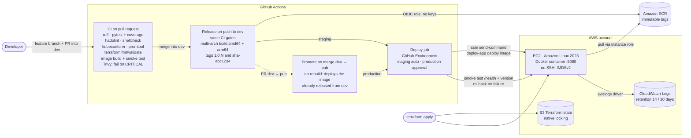
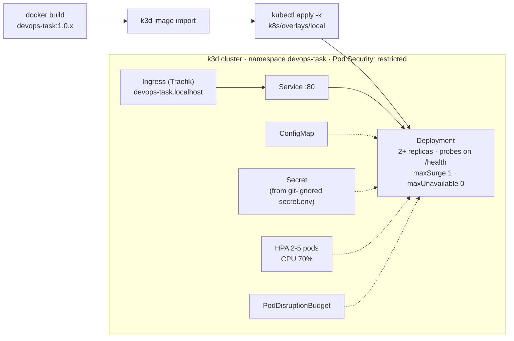
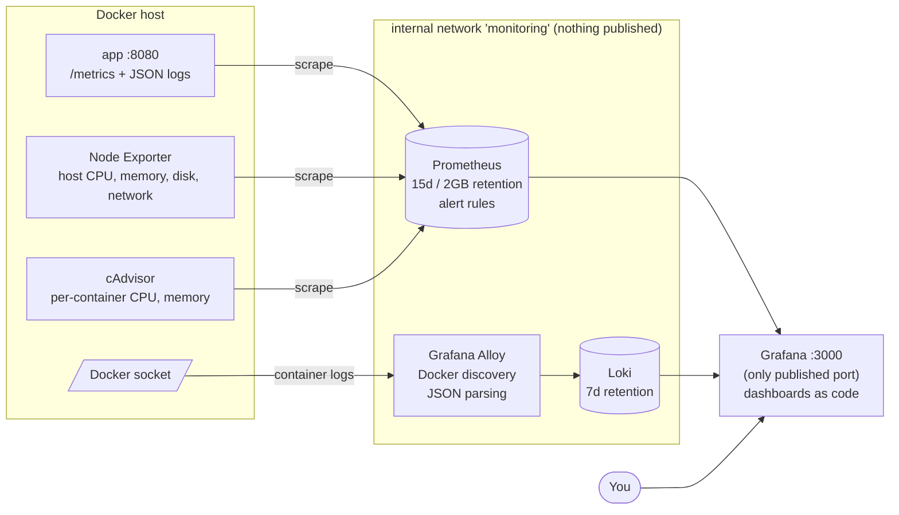
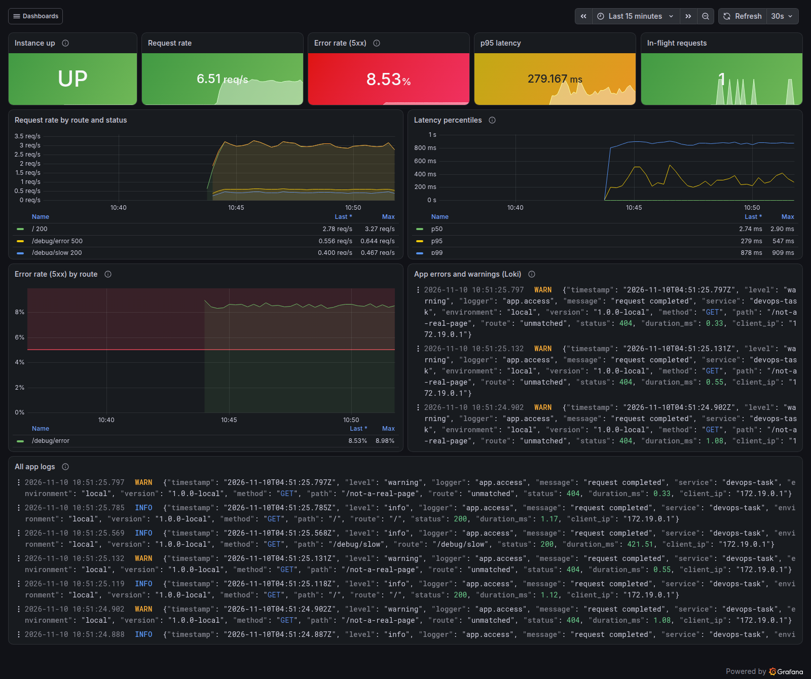
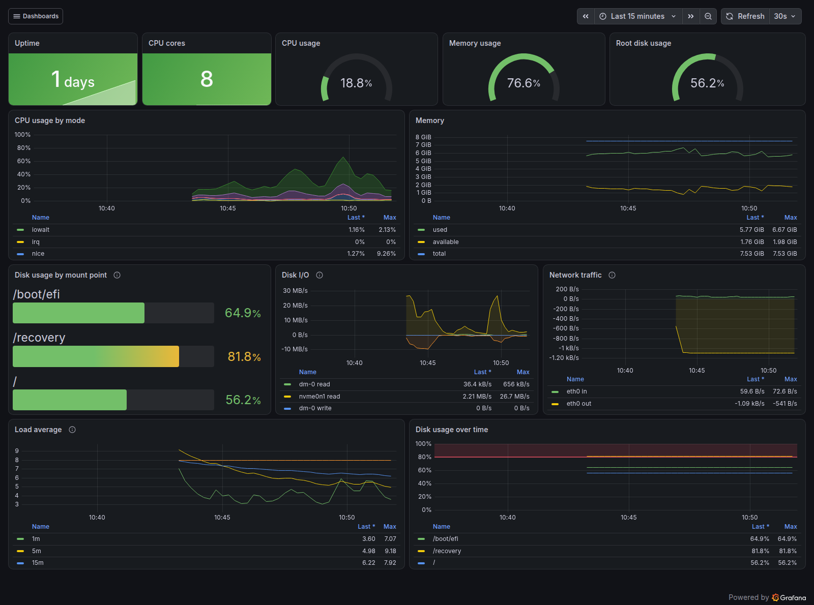
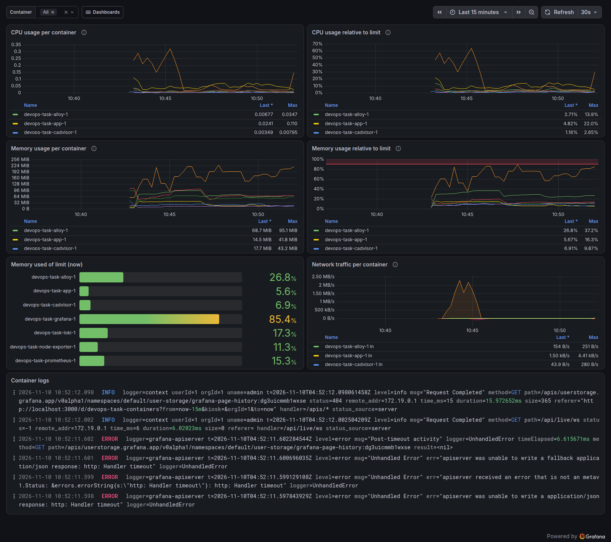
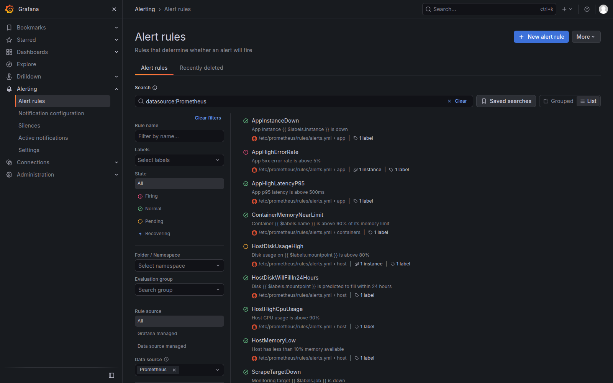

# DevOps Task

A small Python (FastAPI) web service taken from source code to a production-ready,
observable and securely deployed state:

| Area | What is here |
|---|---|
| Application | `GET /`, `GET /health`, `GET /metrics` (Prometheus), JSON logs, env-based config, graceful shutdown, unit tests (98% coverage) |
| Container | Multi-stage Alpine image, pinned base, non-root, read-only filesystem, `HEALTHCHECK`, OCI labels, allow-list `.dockerignore` |
| CI/CD | GitHub Actions: lint, tests + coverage, hadolint, shellcheck, Trivy gate, multi-arch build, ECR via OIDC, deploy to EC2 through SSM with smoke test and automatic rollback |
| Infrastructure | Terraform: EC2 + security group + least-privilege IAM + CloudWatch Logs, S3 remote state with native locking, staging and production from one codebase |
| Kubernetes | Kustomize manifests for k3d: probes, requests/limits, HPA, PDB, NetworkPolicy, restricted Pod Security, ConfigMap + Secret, rolling update and rollback demo |
| Observability | Prometheus, Grafana, Loki, Grafana Alloy, Node Exporter, cAdvisor; dashboards, data sources and alert rules all as code |
| Automation | `system_health.sh` with thresholds, exit codes, JSON output, log rotation, systemd timer |

---

## Contents

1. [Quick start](#1-quick-start)
2. [Running everything](#2-running-everything)
3. [Architecture](#3-architecture)
4. [Application and container](#4-application-and-container)
5. [CI/CD pipeline](#5-cicd-pipeline)
6. [Infrastructure as code (Terraform)](#6-infrastructure-as-code-terraform)
7. [Kubernetes](#7-kubernetes)
8. [Observability](#8-observability)
9. [Health script](#9-health-script)
10. [Design decisions](#10-design-decisions)
11. [Deployment and rollback strategy](#11-deployment-and-rollback-strategy)
12. [Security considerations](#12-security-considerations)
13. [AWS cost estimate](#13-aws-cost-estimate)
14. [What I would improve with more time](#14-what-i-would-improve-with-more-time)
15. [Use of AI tools](#15-use-of-ai-tools)

---

## 1. Quick start

**Prerequisites:** Docker Engine 24+ with Docker Compose v2, `make`, `curl`. A Linux host
is assumed for the monitoring stack (Node Exporter and cAdvisor read host `/proc`,
`/sys` and Docker data; on Docker Desktop they report the Docker VM instead).

```bash
git clone https://github.com/devrkb21/devops-task.git && cd devops-task
cp .env.example .env
# Edit .env: set GRAFANA_ADMIN_PASSWORD, and DEBUG_TOKEN (e.g. `openssl rand -hex 16`)
docker compose up -d --build        # .env sets COMPOSE_PROFILES=monitoring, so this starts everything
```

| What | URL | Notes |
|---|---|---|
| App | http://localhost:8080 | `/`, `/health`, `/metrics` |
| Grafana | http://localhost:3000 | Log in with `GRAFANA_ADMIN_USER` / `GRAFANA_ADMIN_PASSWORD` from `.env`. Dashboards are in the **DevOps Task** folder; *Application* is the home dashboard |

```bash
curl http://localhost:8080/
# {"message":"Hello from DevOps Task!","status":"running","version":"1.0.0-local"}
docker compose ps                    # every service should be "running"/"healthy"
make traffic                         # 5 minutes of traffic, with an error spike if DEBUG_TOKEN is set
```

App only, without monitoring: `COMPOSE_PROFILES= docker compose up -d --build` (a shell
variable overrides `.env`). Stop with `docker compose down` (`make clean` also deletes data volumes).

Run `make help` for every shortcut.

---

## 2. Running everything

### Tests and linters

```bash
python3 -m venv .venv && source .venv/bin/activate
make install          # hash-locked runtime deps + dev tools
make test             # pytest with coverage (fails under 85%)
make lint             # ruff, shellcheck, hadolint
```

### Health script

```bash
scripts/system_health.sh                       # report + entry in ./health_log.txt
scripts/system_health.sh --disk 80 --cpu 90 --mem 85 --json
scripts/system_health.sh --help
```
Details in [section 9](#9-health-script).

### Terraform (AWS)

Needs AWS credentials for an account you control (`aws sts get-caller-identity` must work) and Terraform >= 1.11.

```bash
# 1. One-time bootstrap: state bucket, ECR repository, GitHub OIDC role (local state)
cd terraform/bootstrap
terraform init
terraform apply -var github_repository=devrkb21/devops-task
# Note the outputs: state_bucket, ecr_repository_url, github_actions_role_arn

# 2. Put the state_bucket value into both environments/*.s3.tfbackend files, then:
cd ../app
terraform init -backend-config=environments/staging.s3.tfbackend
terraform plan  -var-file=environments/staging.tfvars -out=staging.tfplan
terraform apply staging.tfplan

# Production uses the same code with a different backend key and variables:
terraform init -reconfigure -backend-config=environments/production.s3.tfbackend
terraform plan -var-file=environments/production.tfvars -out=production.tfplan
```

Clean up afterwards: `terraform destroy -var-file=environments/staging.tfvars` in
`terraform/app`. The bootstrap state bucket has `prevent_destroy`; to remove it, empty the
bucket, delete the lifecycle block and run `terraform destroy` in `terraform/bootstrap`.

Evidence of a real run:

<!-- TODO(candidate): replace with your own output/screenshots after running terraform -->
> **Terraform plan/apply evidence:** see `docs/evidence/terraform-plan.txt` and
> `docs/screenshots/terraform-apply.png` *(to be added after running against AWS)*.

### GitHub Actions setup

The pipeline needs **no secrets**: it authenticates to AWS with OIDC.

| Where | Name | Value |
|---|---|---|
| Repository variable | `AWS_ROLE_ARN` | `github_actions_role_arn` output of bootstrap |
| Repository variable | `AWS_REGION` | e.g. `us-east-1` |
| Repository variable (optional) | `ECR_REPOSITORY`, `PROJECT`, `APP_PORT` | defaults: `devops-task`, `devops-task`, `8080` |
| Environment | `staging` | no protection needed |
| Environment | `production` | **required reviewers** + deployment branch rule `pub` |

Order for a first deploy: bootstrap → set the variables → `terraform apply` staging and
production → push to `dev`. The release workflow builds `1.0.<run>` and deploys it to
staging; merging `dev` into `pub` then deploys the same image to production. Until
`AWS_ROLE_ARN` is set, the build and deploy jobs are skipped and only the CI gates run.

<!-- TODO(candidate): link a successful workflow run or add screenshots -->
> **Deploy evidence:** link to a successful *Release* run / `docs/screenshots/deploy-run.png`
> *(to be added)*.

### Kubernetes (k3d)

Needs [k3d](https://k3d.io) and `kubectl`.

```bash
make k8s-up       # creates cluster, builds + imports image 1.0.0, applies k8s/overlays/local
curl http://devops-task.localhost:8081/
make k8s-demo     # zero-downtime rolling update to 1.0.1, then kubectl rollout undo
make k8s-down
```
Details and recorded output in [section 7](#7-kubernetes).

---

## 3. Architecture

### Delivery pipeline: commit to EC2



### Kubernetes deployment flow



### Observability: how metrics and logs reach Grafana



---

## 4. Application and container

**Code:** `app/` · **Tests:** `tests/` · **Image:** `Dockerfile`

| Endpoint | Response |
|---|---|
| `GET /` | `{"message": "Hello from DevOps Task!", "status": "running", "version": "<APP_VERSION>"}` |
| `GET /health` | `{"status": "ok"}`: used by Docker, Kubernetes probes, the deploy script and the smoke test |
| `GET /metrics` | Prometheus format: `http_requests_total{method,path,status}`, `http_request_errors_total{method,path}` (5xx), `http_request_duration_seconds` histogram, `http_requests_in_progress`, `app_build_info{version,environment}` |
| `GET /debug/error`, `/debug/slow?ms=` | Only exist when `DEBUG_TOKEN` is set, and require header `X-Debug-Token`. Used to demo dashboards and alerts |

**Configuration** (all environment variables, validated at startup, invalid values fail fast):
`PORT` (8080), `LOG_LEVEL` (info), `APP_ENV` (development), `APP_VERSION` (baked into the
image at build time), `GRACEFUL_SHUTDOWN_TIMEOUT` (20 s), `DEBUG_TOKEN` (unset).

**Logs** are one JSON object per line on stdout, for example:

```json
{"timestamp": "2026-11-10T03:17:46.764Z", "level": "info", "logger": "app.access", "message": "request completed", "service": "devops-task", "environment": "local", "version": "1.0.0-local", "method": "GET", "path": "/", "route": "/", "status": 200, "duration_ms": 1.21, "client_ip": "172.18.0.1"}
```
Requests to `/health` and `/metrics` are logged at `debug`, so probes don't flood the logs.
Unhandled exceptions are logged once with the stack trace and the client gets a generic
500 body (no stack trace leak).

**Graceful shutdown:** on `SIGTERM`, uvicorn stops accepting new connections, lets
in-flight requests finish (up to `GRACEFUL_SHUTDOWN_TIMEOUT`), runs the shutdown hook and
exits. Verified by sending `SIGTERM` during a 1.5 s request: the request completed before exit.

**Metric labels** use the route template (`/`, `/health`), never the raw URL; unknown URLs
are grouped as `path="unmatched"`. This keeps the number of time series bounded even if a
scanner requests thousands of random paths.

### Image

| Property | How |
|---|---|
| Multi-stage | Builder installs hash-locked dependencies into a virtualenv; runtime copies only `/opt/venv` and the compiled code |
| Minimal, pinned base | `python:3.13.18-alpine3.24` (exact patch + Alpine release); Dependabot proposes updates |
| Non-root | UID/GID 10001; code owned by root so the app cannot modify it; `pip` removed |
| Health check | `HEALTHCHECK CMD ["python", "-m", "app.healthcheck"]`, no curl needed in the image |
| Metadata | OCI labels: version, revision, created, source |
| `.dockerignore` | Allow-list: only `app/` and `requirements.txt` enter the build context |

**Final image size:** 103 MB uncompressed (`docker image ls devops-task`, Docker 29.1,
linux/amd64). The CI job "Build, smoke test and scan image" also prints it in the run summary.

`docker-compose.yml` runs the app on port 8080 with a health check, `restart:
unless-stopped`, CPU/memory limits, read-only root filesystem, all capabilities dropped,
`no-new-privileges` and log rotation.

---

## 5. CI/CD pipeline

**Branches.** `dev` is the integration branch (the default branch): feature branches are
merged into it through pull requests, and every push to `dev` is released to staging.
`pub` is the production branch: it only changes through a pull request from `dev`, merged
with a merge commit, and every merge is deployed to production. Production therefore only
runs images that were already built, deployed and smoke-tested on staging.

Workflows in `.github/workflows/`:

| Workflow | Trigger | What it does |
|---|---|---|
| `ci.yml` | every pull request into `dev` or `pub` (and reused by `release.yml`) | **test:** ruff lint + format, pytest, coverage table in the job summary, `coverage.xml` artifact. **static-checks:** hadolint, shellcheck, kubeconform on the rendered Kustomize output, promtool on alert rules, dashboard JSON check. **terraform:** `fmt -check`, `validate` for both root modules. **image:** build with layer cache, run the container and smoke-test it (including "is it non-root?"), Trivy report, then a Trivy gate that **fails on CRITICAL** |
| `release.yml` | push to `dev` | runs `ci.yml` again, then (once `AWS_ROLE_ARN` is set) builds **linux/amd64 + linux/arm64** with the GitHub Actions layer cache, pushes to ECR with tags `1.0.<run number>` and `sha-<commit>`, attaches SBOM + provenance, creates git tag `v1.0.<run>`, then calls `deploy.yml` for staging |
| `promote.yml` | push to `pub` (merge of a `dev` → `pub` pull request) | finds the `v1.0.N` release tag behind the merged `dev` commit, refuses if code changed after that tag, then calls `deploy.yml` for production with that **same image** (no rebuild) |
| `deploy.yml` | called by release and promote, or run manually | accepts either tag (`1.0.N` or `sha-xxxxxxx`), verifies it exists in ECR, finds the instance by tags, runs `deploy-app` through **SSM** (no SSH), smoke-tests `/health` from the internet and checks the served version, **rolls back automatically** if the smoke test fails |

Supply-chain hardening: every third-party action is pinned to a **full commit SHA**
(tags can be moved). Trivy runs from the pinned image `aquasec/trivy:0.69.3` rather than
through `aquasecurity/trivy-action`: in March 2026 most `trivy-action` tags were
force-pushed to malicious commits and Trivy 0.69.4 to 0.69.6 were compromised; Aqua
confirmed 0.69.3 as safe.

**Secrets and variables:** no secrets at all. See the table in
[GitHub Actions setup](#github-actions-setup). AWS access is a short-lived OIDC session
whose IAM trust policy only accepts `dev` and the `staging`/`production` environments of
this repository. `GITHUB_TOKEN` (automatic) pushes the git tag.

---

## 6. Infrastructure as code (Terraform)

```
terraform/
├── bootstrap/        one-time, local state: S3 state bucket, ECR, GitHub OIDC + deploy role
└── app/              per environment, S3 backend: EC2, security group, IAM, CloudWatch
    ├── environments/ staging|production .tfvars and .s3.tfbackend
    └── templates/    user data + deploy-app script
```

| Requirement | Implementation |
|---|---|
| EC2 in a VPC, minimal ports | Default VPC; security group allows **only TCP 8080** from `allowed_cidrs`. No port 22: shell access is `aws ssm start-session` |
| Least-privilege instance profile | Pull from **one** ECR repository, write to **one** log group, plus AWS-managed `AmazonSSMManagedInstanceCore` for the SSM agent |
| No static keys | Instance role for the server, OIDC for GitHub. No access key exists anywhere |
| Bootstrap | User data installs Docker and the ECR credential helper, writes config and `/usr/local/bin/deploy-app`, optionally starts `initial_image_tag` |
| Logs to CloudWatch | Docker `awslogs` driver (non-blocking mode) → `/devops-task/<env>/app`, retention 14 days (staging) / 30 days (production) |
| Remote state + locking | S3 bucket (versioned, encrypted, TLS-only, public access blocked) with **S3 native locking** (`use_lockfile = true`, Terraform >= 1.11), so no DynamoDB table |
| Staging and production | Same code; `environments/<env>.tfvars` and `<env>.s3.tfbackend` (separate state keys) |

Further hardening on the instance: IMDSv2 required with **hop limit 1** (containers
cannot reach instance credentials), encrypted gp3 root volume, `ignore_changes` on the AMI
so a new AMI release never replaces the server unexpectedly.

---

## 7. Kubernetes

Manifests: `k8s/base` (plain YAML assembled with Kustomize) and `k8s/overlays/local`.

| Item | Setting |
|---|---|
| Deployment | 2 replicas, `RollingUpdate` with `maxSurge: 1`, `maxUnavailable: 0` |
| Probes | `startupProbe`, `readinessProbe` and `livenessProbe` on `/health`; liveness is more tolerant than readiness so a slow pod is taken out of rotation before it is restarted |
| Resources | requests `100m` CPU / `96Mi`; limits `500m` / `192Mi` |
| Security | `runAsNonRoot`, UID 10001, `readOnlyRootFilesystem`, `allowPrivilegeEscalation: false`, all capabilities dropped, `RuntimeDefault` seccomp, no service-account token; namespace enforces the **restricted** Pod Security Standard |
| Networking | ClusterIP Service, Traefik Ingress `devops-task.localhost` (port-forward alternative: `kubectl -n devops-task port-forward svc/devops-task 8082:80`), NetworkPolicy allowing only the ingress controller and same-namespace pods |
| Config | `ConfigMap app-config`; `Secret app-secrets` generated by Kustomize from the **git-ignored** `secret.env` (a content hash in the name rolls the pods when it changes) |
| Scaling / disruption | HPA on CPU (70% of request, 2-5 pods, slow scale-down), PodDisruptionBudget `minAvailable: 1` |
| Graceful termination | `preStop` sleep of 5 s so the ingress stops routing before the app drains, then SIGTERM |

### Rolling update and rollback

`make k8s-demo` (`scripts/k8s/rolling-update-demo.sh`) builds `1.0.1`, updates the
Deployment while `watch-availability.sh` sends a request every 100 ms, then runs
`kubectl rollout undo` the same way. Commands used:

```bash
kubectl -n devops-task set image deployment/devops-task app=devops-task:1.0.1
kubectl -n devops-task rollout status deployment/devops-task
kubectl -n devops-task rollout history deployment/devops-task
kubectl -n devops-task rollout undo deployment/devops-task
```

<!-- TODO(candidate): run `make k8s-up && make k8s-demo` and paste the real output here -->
Recorded output:

```text
(paste the output of `make k8s-demo` here: version switch 1.0.0 -> 1.0.1 -> 1.0.0
 with "failed: 0" in both availability summaries, plus the rollout history)
```

### How this changes for production on EKS

- **Ingress:** AWS Load Balancer Controller with an ALB `Ingress`, TLS certificate from ACM, and WAF in front.
- **Secrets:** AWS Secrets Manager or SSM Parameter Store, synced with External Secrets Operator (or the Secrets Store CSI driver), instead of files.
- **IAM for pods:** IRSA or EKS Pod Identity, so each workload gets its own narrow role and nodes keep a minimal one.
- **Nodes:** managed node groups across 3 AZs with Karpenter or Cluster Autoscaler; `topologySpreadConstraints` across zones; the HPA stays.
- **Images:** pulled from ECR by immutable tag (or digest); admission policy (Kyverno/Gatekeeper) requiring signed images and blocking `:latest`.
- **Delivery:** GitOps with Argo CD or Flux, a Kustomize overlay or Helm values file per environment, progressive delivery (Argo Rollouts canary) for risky changes.
- **Observability:** kube-prometheus-stack + Loki via Helm, or Amazon Managed Prometheus/Grafana; metrics via `ServiceMonitor` instead of static scrape targets.

---

## 8. Observability

Everything is code under `monitoring/`, started by the `monitoring` Compose profile.

| Component | Image | Role |
|---|---|---|
| Prometheus | `prom/prometheus:v3.16.0` | Scrapes app, Node Exporter, cAdvisor and the stack itself; evaluates alert rules. Retention **15 days / max 2 GB** |
| Grafana | `grafana/grafana:13.3.0` | Data sources and dashboards provisioned from files; UI edits disabled. **Only service published to the host** (3000) |
| Loki | `grafana/loki:3.7.9` | Log store; compactor retention **7 days** |
| Grafana Alloy | `grafana/alloy:v1.21.3` | Discovers containers via the Docker API, parses the app's JSON logs, ships to Loki |
| Node Exporter | `prom/node-exporter:v1.12.1` | Host CPU, memory, disk, network |
| cAdvisor | `ghcr.io/google/cadvisor:v0.60.6` | Per-container CPU, memory (incl. limits), network |

All versions are pinned. Prometheus, Loki, Alloy, Node Exporter and cAdvisor are only on
the `monitoring` network, declared `internal: true` (no published ports, no route out).

### Dashboards (`monitoring/grafana/dashboards/*.json`)

- **Application:** instance up, request rate, 5xx error rate, p95 latency, in-flight
  requests; rate by route and status; p50/p95/p99 latency; error rate by route **with
  the Loki error/warning log panel right next to it**; all app logs.
- **Host:** uptime, cores, CPU/memory/root-disk gauges, CPU by mode, memory, disk usage
  by mount point, disk I/O, network, load average vs cores, disk usage over time.
- **Containers:** CPU per container and relative to its CPU limit, memory working set
  and **memory relative to the configured limit** (time series + current bar gauge),
  network per container, and a logs panel filtered by the same container variable.

Screenshots from a local run: `make up`, then 8 minutes of `scripts/generate-traffic.sh`
with `DEBUG_TOKEN` set, so about one request in five returns HTTP 500 (the error spike).

| Application | Host | Containers |
|---|---|---|
|  |  |  |

Alerts during the same run ([`docs/evidence/alerts-firing.txt`](docs/evidence/alerts-firing.txt)):
**AppHighErrorRate** (critical) went pending once the 5xx ratio passed 5% and fired after
its 5-minute `for` window, at 8.5%. **HostDiskUsageHigh** went pending for a real reason:
the laptop's small `/recovery` partition is 82% full.



### Log pipeline and label choices

Loki indexes **labels**; every unique label combination is a separate stream, so labels
must have few possible values. Alloy sets only:

| Label | Values | Why |
|---|---|---|
| `service` | compose service name (app, loki, ...) | main selector, ~7 values |
| `container` | container name | lets the Containers dashboard link logs to metrics |
| `level` | debug/info/warning/error/critical (app only) | the most common filter, 5 values |
| `environment` | `local` | separates environments when shipped centrally |

`path`, `method` and `status` are attached as **structured metadata**: filterable
(`{service="app"} | status="500"`) but not indexed, so a burst of distinct URLs cannot
explode the number of streams. Timestamps, durations and client IPs stay in the log line.

### Alerting rules (`monitoring/prometheus/rules/alerts.yml`)

Visible in Grafana under *Alerting → Alert rules* (data source-managed).

| Alert | Condition | `for` | Reasoning |
|---|---|---|---|
| `AppInstanceDown` | `up{job="app"} == 0` | 1m | Total outage, page fast; 1 min (4 scrapes) avoids paging on a single missed scrape or a restart |
| `AppHighErrorRate` | 5xx / requests > **5%** (probes and scrapes excluded) and > 0.1 req/s | 5m | 5% is far above normal (≈0%) but tolerates a few failing requests; the traffic floor stops one failed request at night from being "100% errors"; 5 min filters short blips such as a deploy |
| `AppHighLatencyP95` | p95 > **500 ms** | 10m | The service does no I/O, so p95 is normally a few ms; 500 ms means users feel it. Longer `for` because latency is noisier than errors |
| `HostDiskUsageHigh` | any real filesystem > **80%** | 10m | Leaves headroom (20%) to react before writes fail; 10 min ignores temporary files |
| `HostDiskWillFillIn24Hours` | linear prediction over 6h says full within 24h, and < 40% free | 30m | Catches fast growth (e.g. runaway logs) long before 80% |
| `HostHighCpuUsage` | CPU > **90%** | 15m | Short CPU spikes are normal; 15 min of saturation means sustained overload |
| `HostMemoryLow` | available < **10%** | 10m | Below this the kernel starts swapping/OOM-killing |
| `ContainerMemoryNearLimit` | working set > **90%** of the container's limit | 5m | At 100% the container is OOM-killed; working set is what the kernel counts against the limit |
| `ScrapeTargetDown` | any other target down | 5m | Missing monitoring data is itself a problem, but less urgent than the app |

### Privileged components: mounts and why

| Component | Access | Why | Risk and mitigation |
|---|---|---|---|
| Node Exporter | `pid: host`; read-only `/proc` → `/host/proc`, `/sys` → `/host/sys`, `/` → `/rootfs` (rslave) | Host metrics live in the host's procfs/sysfs; the root mount is needed to measure filesystem usage | All read-only, no capabilities. Network counters show the container's network namespace unless run with `network_mode: host`, which I did not use so it stays on the internal network |
| cAdvisor | `privileged: true`; `/dev/kmsg`; read-only `/`, `/var/run`, `/sys`, `/var/lib/docker`, `/dev/disk` | Reads cgroup stats and OOM events for every container; upstream documents privileged mode as required on cgroup v2 / RHEL-family hosts | Privileged = effectively root on the host. Accepted for a local stack; in Kubernetes the kubelet's built-in cAdvisor is used instead |
| Grafana Alloy | runs as root; Docker socket mounted `:ro` | Container discovery and log reading go through the Docker API | `:ro` only protects the socket *file*; the API is still full access, i.e. root-equivalent. Improvement: a socket proxy that only allows `GET /containers` and `/logs` |

### Investigating an error spike

> *"An error spike appears on the Application dashboard. How do you find the cause?"*

1. **Confirm and scope it.** On *Application*, the *Error rate (5xx)* stat is red and
   *Error rate by route* shows **which route** is failing and when it started. Check
   whether `AppHighErrorRate` is pending/firing under *Alerting*.
2. **Read the errors in the same view.** The *App errors and warnings* Loki panel next to
   it shows the error lines for exactly that time range. Expanding one shows the method,
   path, status and the **stack trace** from the JSON log.
3. **Narrow down in Explore:**
   `{service="app", level="error"} | path="/debug/error"` or count errors per route with
   `sum by (path) (count_over_time({service="app", level="error"}[1m]))`.
4. **Was it a deploy?** `app_build_info` shows the running version; if the spike starts
   when the version changes, roll back (run the *Deploy* workflow with the previous tag).
5. **Is it resources?** *Latency percentiles* rising together with errors suggests
   saturation or timeouts. On *Containers*, check memory against the limit (OOM restarts)
   and CPU against its limit (throttling); on *Host*, check disk full, CPU, memory.
6. **Fix, then verify** the error rate returns to ~0 and the alert resolves.

To reproduce: set `DEBUG_TOKEN` in `.env`, `docker compose up -d`, then `make traffic`.

---

## 9. Health script

`scripts/system_health.sh` (Bash, `set -euo pipefail`, shellcheck clean):

- Collects **CPU usage** (sampled from `/proc/stat`), **memory usage** (`MemAvailable`),
  **disk usage of every real mounted filesystem** (pseudo filesystems and snap images
  skipped), **load average** and the **top 5 processes by memory**.
- **Thresholds:** `--cpu 90 --mem 85 --disk 80` (warning, defaults shown) and
  `--cpu-crit 98 --mem-crit 95 --disk-crit 95`; prints `[WARNING]` / `[CRITICAL]` lines.
- **Exit codes:** `0` healthy, `1` warning, `2` critical, `3` unknown (bad arguments or
  not Linux), the Nagios convention most monitoring tools understand.
- **Output:** human-readable report, or `--json` (stdout stays pure JSON, alerts go to stderr).
- **Log:** appends a timestamped one-line entry (or a JSON line) to `health_log.txt`
  (`--log-file`), **rotated** when it exceeds `--max-log-kb` (1024), keeping `--keep` (5) files.
- `flock` prevents two runs overlapping; `HEALTH_WEBHOOK_URL` (optional) posts
  WARNING/CRITICAL to Slack or Discord; `--help`, `--version`.

Every 5 minutes with systemd (preferred):

```bash
sudo install -m 0755 scripts/system_health.sh /usr/local/bin/system_health.sh
sudo cp scripts/systemd/system-health.{service,timer} /etc/systemd/system/
sudo systemctl daemon-reload && sudo systemctl enable --now system-health.timer
systemctl list-timers system-health.timer
```
The service runs as a throwaway `DynamicUser` that can only write
`/var/log/system-health`; exit 1 (warning) counts as success, exit 2 marks the unit failed.
Cron alternative: `sudo cp scripts/cron/system-health /etc/cron.d/system-health`.

---

## 10. Design decisions

**Python + FastAPI over Go.** FastAPI is quick to read and review, and the stack is small.
Go would produce a ~15 MB static image; Python is ~XX MB. For a service this size,
readability and fast iteration were worth more than the size difference.

**Alpine over distroless.** Distroless Python images ship Debian's Python and can only be
pinned by digest; Alpine lets me pin an exact Python patch release
(`3.13.18-alpine3.24`) and stays small. The trade-offs are musl libc (all dependencies
publish musllinux wheels, so nothing compiles) and a shell in the image, which I limit by
running non-root on a read-only filesystem with all capabilities dropped.

**Hash-locked dependencies.** `requirements.txt` is generated with
`pip-compile --generate-hashes` and installed with `--require-hashes`: a tampered or
substituted package fails the build.

**One process per container.** A single uvicorn worker; scaling is done by adding
containers or pods, which the orchestrator can health-check and restart individually.

**EC2 over ECS or EKS.** The task asks for EC2, and for one small service it is the
cheapest and most transparent option. EKS costs ~$73/month for the control plane alone and
adds a lot of moving parts; ECS Fargate would be my production choice for this service
(managed rolling deploys, no servers to patch). Section 13 compares costs.

**Deploy through SSM, not SSH.** No port 22, no SSH keys to rotate or leak; every command
is authorized by IAM and audited in CloudTrail.

**Tagging.** Images get two **immutable** tags: `MAJOR.MINOR.<run number>` (human-readable,
always increasing, no manual bump) and `sha-<commit>` (traceability). No `latest`: it is
mutable and makes "what is running?" unanswerable. ECR enforces immutability.

**Build once, promote.** Production receives the exact image that passed staging, by tag,
without a rebuild.

**Secrets.** There are no long-lived credentials anywhere: GitHub uses OIDC, EC2 uses an
instance role, Docker uses the ECR credential helper. App secrets locally come from a
git-ignored `.env`; in Kubernetes from a git-ignored `secret.env` via `secretGenerator`.
In production they would live in AWS Secrets Manager / SSM Parameter Store.

**Log labels.** Few, low-cardinality labels; per-request fields as structured metadata
(see section 8).

**Terraform layout.** `bootstrap` (applied once, local state) creates what the main
configuration's backend depends on. One root module for all environments with partial
backend config avoids copy-pasted environment folders. S3 native locking replaces the
DynamoDB lock table, which HashiCorp has deprecated.

**Prometheus alert rules rather than Grafana-managed alerts.** Rules are plain YAML
validated by `promtool` in CI, and keep working if Grafana is down.

---

## 11. Deployment and rollback strategy

**How a release reaches production**

1. Work on a feature branch, open a pull request into `dev`. `ci.yml` must pass (tests, linters, Trivy, Terraform validation).
2. Merge into `dev`. `release.yml` re-runs the gates, builds the multi-arch image once, pushes `1.0.N` + `sha-xxxxxxx` to ECR and tags the commit `v1.0.N`.
3. The image is deployed to **staging** automatically: `deploy-app` pulls it, restarts the
   container, and waits for `/health`; then the workflow smoke-tests `/health` from
   outside and checks `/` reports version `1.0.N`.
4. To promote: open a pull request from `dev` into `pub` and merge it with a merge commit.
   `promote.yml` finds the release tag behind the merged `dev` commit and deploys that same
   image to production. The `production` GitHub Environment requires a reviewer's approval
   and only allows `pub`.

**How to roll back**

| Situation | Rollback |
|---|---|
| New container never becomes healthy | `deploy-app` restarts the previous image by itself and the job fails |
| Healthy on the host but the external smoke test fails | The workflow runs `deploy-app rollback` through SSM |
| Problem found later | Run **Deploy** with the previous known-good tag (immutable tags guarantee it is the same artifact); or `deploy-app rollback` via SSM |
| Kubernetes | `kubectl rollout undo deployment/devops-task` (history kept: `revisionHistoryLimit: 5`) |
| Infrastructure | Revert the Terraform commit and apply; state is versioned in S3 |

**Known limitation:** with one EC2 instance, swapping the container causes a few seconds
of unavailability while the new one starts. For zero downtime in production I would put
an ALB in front of two instances (or ECS tasks) and roll one at a time, or run blue/green.
The Kubernetes setup already does this with `maxUnavailable: 0`.

---

## 12. Security considerations

- **Secrets management:** no secrets in the repository, the image or GitHub. AWS access via
  OIDC (CI) and instance roles (EC2); ECR pulls via the credential helper; `.env`,
  `secret.env` and Terraform state files are git-ignored; Grafana refuses to start
  without an admin password. Production: AWS Secrets Manager + External Secrets.
- **Image scanning:** Trivy in CI fails on CRITICAL vulnerabilities and reports HIGH; ECR
  scans on push; Dependabot keeps the base image, Python packages, actions and providers up to date;
  SBOM and provenance attestations are attached to every release image.
- **Supply chain:** actions pinned to commit SHAs, Trivy pinned to a verified-safe image,
  hash-locked Python dependencies, pinned base and monitoring images.
- **IAM:** the CI role can push to one repository and send commands only to instances
  tagged with this project, and only from `dev` or the two environments; the instance role
  can pull one repository and write one log group.
- **Network exposure:** EC2 exposes only port 8080 (restrict `allowed_cidrs` for staging);
  no SSH. Locally only the app (8080) and Grafana (3000) are published; the rest of the
  monitoring stack is on an internal network. In Kubernetes a NetworkPolicy limits who can reach the pods.
- **Runtime hardening:** non-root UID 10001, read-only root filesystem, all capabilities
  dropped, `no-new-privileges`, resource limits, restricted Pod Security; IMDSv2 with hop
  limit 1; encrypted EBS and S3; S3 state bucket denies non-TLS access.
- **Accepted risks:** privileged cAdvisor and Docker-socket access for Alloy on the local
  monitoring host (see section 8); public HTTP without TLS on the demo EC2 instance
  (production would terminate TLS on an ALB with an ACM certificate).

---

## 13. AWS cost estimate

Rough monthly on-demand prices for **us-east-1** (730 hours), excluding tax and Free
Tier; confirm with the [AWS Pricing Calculator](https://calculator.aws/).

**As built (one production instance):**

| Item | Assumption | ≈ USD/month |
|---|---|---|
| EC2 `t3.small` | $0.0208/hour | 15.20 |
| EBS gp3 | 30 GB × $0.08 | 2.40 |
| Public IPv4 address | $0.005/hour | 3.65 |
| CloudWatch Logs | 2 GB ingested ($0.50/GB) + storage | 1.10 |
| ECR storage | ~2 GB of images (multi-arch, 30 kept) | 0.20 |
| S3 state, SSM Run Command, OIDC | negligible / free | < 0.10 |
| Data transfer out | under the 100 GB/month free allowance | 0 |
| **Total** | | **≈ $22-23** |

Staging (`t3.micro`, 20 GB) adds about $13/month, or is covered by Free Tier credits.

**Highly available alternatives:** 2 × `t3.small` behind an ALB ≈ $65/month; ECS Fargate
with 2 small tasks + ALB ≈ $45/month; EKS ≈ $73/month for the control plane before any nodes.

---

## 14. What I would improve with more time

- Zero-downtime EC2 deploys: ALB + Auto Scaling group (or ECS) with rolling or blue/green deployments, plus HTTPS with ACM.
- Alertmanager routing alerts to Slack/Discord with grouping and silences; runbook links in annotations.
- Docker socket proxy for Alloy so it only gets read access to container lists and logs.
- Sign images with Cosign and verify signatures before deploy.
- OpenTelemetry tracing with Grafana Tempo, linked from Loki logs via trace IDs.
- Helm chart (or more Kustomize overlays) for staging/production, and kube-prometheus-stack in the cluster.
- Ansible playbook for server hardening and installing the health script on EC2.
- VPC endpoints for ECR/SSM/CloudWatch so the instance needs no internet egress; a private subnet behind the load balancer.
- Terraform: `tflint`/`checkov` in CI and a `terraform plan` comment on pull requests.
- Load tests (k6) to set HPA targets and alert thresholds from data instead of judgement.

---

## 15. Use of AI tools

<!-- TODO(candidate): make this statement accurate for how you actually worked -->
I used an AI assistant as a pair programmer: to discuss the design,
draft parts of the code, configuration and documentation, and look up current tool
versions and security advisories (for example the March 2026 Trivy incident). I reviewed
every file, ran the tests, linters and the local stack myself, and I can explain each
part of this submission and the reasoning behind it.
